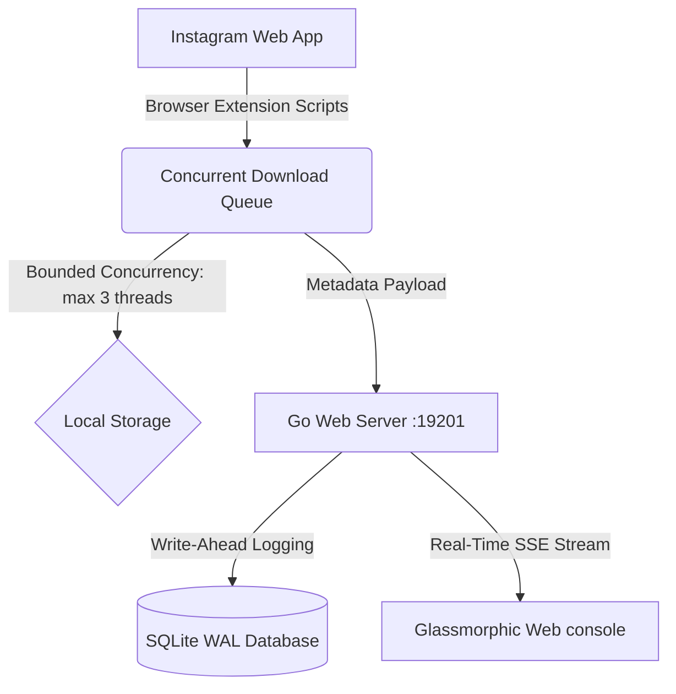

# 📸 InstaVault — Self-Hosted Instagram Mass Downloader & Archiver

> **A high-performance, self-hosted media archiving system designed specifically for Instagram.** InstaVault consists of an **Instagram Companion Browser Extension** that grabs assets in high quality, paired with a lightweight **Go Backend Server & SQLite Database** that manages your offline media vault.

---

## 🎨 Professional, Premium Web UI Console
Access **[http://localhost:19201](http://localhost:19201)** to manage and browse your offline repository:
*   **Unified Dashboard:** Inspect overall storage statistics (total downloads, skipped items, unique profiles) and view interactive, live-streaming background logs inside a glassmorphic terminal panel.
*   **Rebranded Media Vault (`/vault`):** An immersive gallery mimicking modern Instagram aesthetics. Group carousels and reels, perform debounced searches, switch between media filters, and enjoy seamless, pre-fetched infinite scroll.
*   **Multi-Level Sub-Routing:** Built on the HTML5 History API (`pushState`), allowing clean, shareable paths:
    *   `/vault/:username` — Browse a specific profile vault and bio folder.
    *   `/vault/:username/reels` or `/vault/reels` — Filter gallery directly to video reels.
    *   `/vault/:username/p/:shortcode` — Load specific posts with the split-screen Lightbox pre-opened.
*   **Downloads Log:** Review detailed records including file sizes, local storage paths, and download timestamps.
*   **Skipped Duplicates History:** Clear system duplicate filters to re-download designated files.
*   **Settings Console:** Dynamically read and modify your local base storage directories.

---

## 🏗️ Technical Architecture Highlights



### 1. High-Performance Download Pooling & Bounding
*   **Shared TCP Transport:** The Chrome companion extension reuses a shared, active connection pool for ultra-fast asset downloads.
*   **Bounded Concurrency:** Limits simultaneous active downloads to **3 threads**, ensuring you stay within Instagram rate limits and preventing local network choking.
*   **Atomic Stage-Renaming:** Stage-renaming files from `.tmp` to final extensions on successful completion guarantees zero partial or corrupt file records in your vault.

### 2. Lock-Free Database Core (SQLite WAL Engine)
*   **Write-Ahead Logging (WAL):** Enabled WAL mode inside SQLite so reader connections never block writers, allowing lightning-fast background download syncs while you browse the gallery.
*   **Thread Safety:** Strong internal Mutex synchronization inside the Go server (`dbMu`) locks write transactions safely across multiple parallel routines.

### 3. Pre-Fetching Infinite Scroll Observer
*   Replaces outdated, heavy pagination lists with a high-performance `IntersectionObserver` viewport listener.
*   Triggers next-page data fetches **150px before** the user scrolls to the sentinel, ensuring a flawless, uninterrupted scroll experience.

---

## 🛠️ Complete Server Installation & Autostart Guide

The Go backend server runs on **port 19201** by default.

### 🐧 Linux Setup (Recommended for Debian/Ubuntu/Fedora)

We provide an interactive **All-in-One CLI Control Center** (`manage.sh`) that automates everything: compiling Go binaries, starting/stopping systemd user-space autostart daemons, and reading live logs.

1. **Make the management script executable**:
   ```bash
   chmod +x manage.sh
   ```
2. **Launch the interactive menu**:
   ```bash
   ./manage.sh
   ```
   *   `1` — **Build Server**: Compiles Go static files.
   *   `2` — **Start / Restart**: Brings the server online.
   *   `3` — **Stop Server**: Powers off background processes.
   *   `4` — **Check Diagnostics**: Verifies SQLite health, database sizes, and active port bindings.
   *   `5` — **Tail Logs**: Streams live terminal events directly.
   *   `6` — **Configure Autostart**: Sets up background systemd user configurations automatically!

#### Manual systemd Configuration (Background Daemon)
You can configure a user-space systemd service that starts automatically on user login and keeps the server running in the background without root/sudo access:
1. Create a service file at `~/.config/systemd/user/instavault.service`:
   ```ini
   [Unit]
   Description=InstaVault Server (Instagram Mass Downloader)
   After=network.target

   [Service]
   ExecStart=/home/YOUR_USERNAME/mass-downloader-for-instagram/server/instavault-server
   Restart=always
   WorkingDirectory=/home/YOUR_USERNAME/mass-downloader-for-instagram/server

   [Install]
   WantedBy=default.target
   ```
2. Reload systemd, enable, and start the service:
   ```bash
   systemctl --user daemon-reload
   systemctl --user enable instavault.service
   systemctl --user start instavault.service
   ```
3. To view status and logs:
   ```bash
   systemctl --user status instavault.service
   ```

---

### 🪟 Windows Setup

#### 1. Manual Execution
Navigate to the `server/` folder and execute the precompiled binary inside PowerShell:
```powershell
cd server
.\instavault-server.exe
```

#### 2. Autostart via Windows Task Scheduler (Recommended)
To run the server silently in the background on login:
1. Open **Task Scheduler** and click **Create Basic Task** in the right pane.
2. Name the task `InstaVaultServer` and set the Trigger to **When I log on**.
3. Set the Action to **Start a program** and browse to `instavault-server.exe`.
4. In the **Start in (optional)** field, paste the absolute path to your `server` folder (essential for loading configuration settings!).
5. Click **Finish**. To make it run completely in the background without a command prompt window popping up, double-click the task under Task Scheduler Library, choose **Run whether user is logged on or not**, and check **Do not store password**.

---

### 🍏 macOS Setup

#### 1. Autostart via launchd Agent (Recommended)
To run the server in the background as a LaunchAgent on login:
1. Create a plist file at `~/Library/LaunchAgents/com.vampdued.instavault.plist`:
   ```xml
   <?xml version="1.0" encoding="UTF-8"?>
   <!DOCTYPE plist PUBLIC "-//Apple//DTD PLIST 1.0//EN" "http://www.apple.com/DTDs/PropertyList-1.0.dtd">
   <plist version="1.0">
   <dict>
       <key>Label</key>
       <string>com.vampdued.instavault</string>
       <key>ProgramArguments</key>
       <array>
           <string>/Users/YOUR_USERNAME/mass-downloader-for-instagram/server/instavault-server</string>
       </array>
       <key>WorkingDirectory</key>
       <string>/Users/YOUR_USERNAME/mass-downloader-for-instagram/server</string>
       <key>RunAtLoad</key>
       <true/>
       <key>KeepAlive</key>
       <true/>
       <key>StandardOutPath</key>
       <string>/Users/YOUR_USERNAME/Library/Logs/instavault.log</string>
       <key>StandardErrorPath</key>
       <string>/Users/YOUR_USERNAME/Library/Logs/instavault.err.log</string>
   </dict>
   </plist>
   ```
2. Load and start the agent:
   ```bash
   launchctl bootstrap gui/$(id -u) ~/Library/LaunchAgents/com.vampdued.instavault.plist
   ```

---

## 🧩 Chrome Extension Installation

To link your browser to the local storage server:

1. Open your browser and navigate to **Extensions** (`chrome://extensions`).
2. Toggle on **Developer mode** in the top-right corner.
3. Click **Load unpacked** in the top-left corner.
4. Select the root folder of this repository (`mass-downloader-for-instagram/`).
5. Open Instagram and you will find the mass downloader widgets active! Downloaded media will be organized beautifully inside folders by Instagram username in your designated download directory.

---

## 📡 REST API Documentation

InstaVault exposes a clean JSON REST API for querying offline metadata.

### 1. System Statistics
*   **Endpoint:** `GET /api/stats`
*   **Description:** Fetch cumulative database stats.
*   **Response Payload:**
    ```json
    {
      "totalDownloads": 512,
      "totalSkipped": 38,
      "uniqueAccounts": 14
    }
    ```

### 2. Grouped Profile Directory
*   **Endpoint:** `GET /api/accounts`
*   **Description:** Get downloaded post counts grouped per user profile.
*   **Response Payload:**
    ```json
    [
      { "username": "diyasissyy", "count": 128 },
      { "username": "instagram", "count": 4 }
    ]
    ```

### 3. Unified Media Vault List
*   **Endpoint:** `GET /api/posts`
*   **Description:** Query posts catalog. Supports full query parameter filtering.
*   **Query Parameters:**
    *   `page`: Target page number (default `1`).
    *   `limit`: Items per page (default `24`).
    *   `type`: Filter media format (`posts` excludes videos; `reels` selects videos only).
    *   `sort`: Ordering (`newest` or `oldest`).
    *   `username`: Filter by specific Instagram handle.
    *   `search`: Case-insensitive text search.
    *   `shortcode`: Fetch a single post object directly to trigger the lightbox.
*   **Response Payload:**
    ```json
    [
      {
        "id": 842,
        "username": "diyasissyy",
        "shortcode": "Ct7_8q2s1",
        "timestamp": "2026-05-25T13:00:00Z",
        "media": [
          {
            "filename": "Ct7_8q2s1_1.jpg",
            "localPath": "/home/vampdued/Downloads/Instagram/diyasissyy/Ct7_8q2s1_1.jpg",
            "size": 182740
          }
        ]
      }
    ]
    ```

### 4. Delete Profile Archive
*   **Endpoint:** `DELETE /api/purge?username=diyasissyy`
*   **Description:** Purge all database records and physically delete the target profile's local download directory.
*   **Response Payload:**
    ```json
    {
      "status": "success",
      "message": "Successfully purged profile diyasissyy and removed 128 items."
    }
    ```

### 5. Live Server logs Stream
*   **Endpoint:** `GET /api/logs`
*   **Description:** Server-Sent Events (SSE) stream broadcasting background system log statements to the web UI.

---

## 🛟 Troubleshooting & Diagnostics

> [!WARNING]
> **Static Embeds Cache:** If you edit HTML, CSS, or JS files inside `server/ui/`, you **must** compile the Go server (`go build`) and restart the daemon so the embedded static asset system serves the updated files.

### Common Issues:
1. **Extension cannot connect to Server:**
   *   Ensure the Go background service is active (`systemctl --user status instavault.service`).
   *   Check if port 19201 is active: `netstat -tuln | grep 19201`.
2. **Media files do not render in Web UI:**
   *   Ensure you have configured the absolute path to your download folder in the **Settings** view of the Dashboard (it must match the folder path where the Chrome Extension downloads assets).
