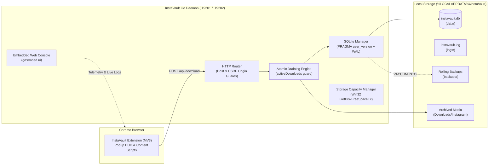
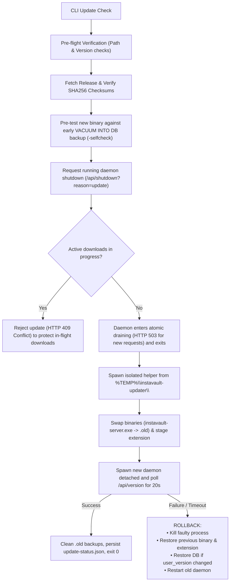

<p align="center">
  <picture>
    <source media="(prefers-color-scheme: dark)" srcset="InstaVault-Brand-Kit/logo/svg/logo-horizontal-reversed.svg">
    <source media="(prefers-color-scheme: light)" srcset="InstaVault-Brand-Kit/logo/svg/logo-horizontal.svg">
    
  </picture>
</p>

<p align="center">
  <strong>Local-first media archiving and synchronization ecosystem for Instagram.</strong><br/>
  High-performance pure-Go daemon paired with an unpacked Manifest V3 Chrome extension.
</p>

<p align="center">
  <a href="#-quick-start-windows-11"></a>
  <a href="#-architecture"></a>
  <a href="InstaVault-Brand-Kit/brand-guidelines.html"></a>
  <a href="#-security-model"></a>
</p>

---

## 🏗️ Architecture



### Key Components
1. **Chrome Extension** ([`extension/`](file:///c:/Users/VampDued/Documents/mass-downloader-for-instagram/extension)): Scrapes full-resolution carousel photos, videos, and profile metadata. Configurable daemon endpoint (defaults to `:19201`, switches to `:19202` for dev mode).
2. **Go Daemon** ([`server/`](file:///c:/Users/VampDued/Documents/mass-downloader-for-instagram/server)): Compiled with `CGO_ENABLED=0` using `modernc.org/sqlite`. Runs headless on Windows (`-H=windowsgui`) with STD handles redirected to logs.
3. **Web Console** ([`server/ui/`](file:///c:/Users/VampDued/Documents/mass-downloader-for-instagram/server/ui)): Deep slate aesthetic, live tail console, shortcode post grouping, real-time disk storage gauge, and zero-dependency SPA architecture embedded via `go:embed`.
4. **Brand System** ([`InstaVault-Brand-Kit/`](file:///c:/Users/VampDued/Documents/mass-downloader-for-instagram/InstaVault-Brand-Kit)): Unified design tokens, SVG lockups, multi-resolution app icons, and an interactive design guidelines manual.

---

## 🎨 Brand Identity & Design System

InstaVault's visual language combines camera optics with high-security vault motifs. The mark is a unified glyph featuring an outer camera chassis, a concentric vault dial lens, and an angled Vault "V" center reticle.

<p align="center">
  <picture>
    <source media="(prefers-color-scheme: dark)" srcset="InstaVault-Brand-Kit/logo/svg/logo-stacked-reversed.svg">
    <source media="(prefers-color-scheme: light)" srcset="InstaVault-Brand-Kit/logo/svg/logo-stacked.svg">
    
  </picture>
</p>

- **Interactive Guidelines**: Open [`InstaVault-Brand-Kit/brand-guidelines.html`](file:///c:/Users/VampDued/Documents/mass-downloader-for-instagram/InstaVault-Brand-Kit/brand-guidelines.html) in your browser for live interactive typography, clear-space rules, and SVG lockup inspections.
- **Design Tokens**: Standardized CSS variables live in [`InstaVault-Brand-Kit/brand-tokens.css`](file:///c:/Users/VampDued/Documents/mass-downloader-for-instagram/InstaVault-Brand-Kit/brand-tokens.css).

### Color Palette

| Swatch | Color Name | Hex Code | CSS Token | Role / Semantic Usage |
|:---:|---|:---:|---|---|
| 🟦 | **Vault Blue** | `#1E5FD8` | `--iv-blue` | Primary brand color, key actions, active navigation pill |
| 🔷 | **Deep Blue** | `#1544BF` | `--iv-blue-deep` | Button hover states, dark gradient endpoints |
| 🩵 | **Sky Blue** | `#5B9BFF` | `--iv-blue-light` | Gradient start accents, dark-theme contrast highlights |
| 🌑 | **Midnight Navy** | `#0B1F4D` | `--iv-midnight` | Deep headers, high-contrast dark surfaces, primary dark text |
| 🩶 | **Slate** | `#5B6B8C` | `--iv-slate` | Secondary metadata, muted labels, subtle borders |
| 🤍 | **Mist** | `#E8F0FD` | `--iv-mist` | Soft tint backgrounds, hover highlights, light badge fills |

### Typography

- **Primary Typeface**: [Inter](https://fonts.google.com/specimen/Inter) (`font-weight: 400, 500, 600, 800`)
- **System Fallbacks**: `'Helvetica Neue', Arial, sans-serif`
- **Monospace Telemetry**: `ui-monospace, Menlo, Consolas, monospace`

### Asset Catalog ([`InstaVault-Brand-Kit/`](file:///c:/Users/VampDued/Documents/mass-downloader-for-instagram/InstaVault-Brand-Kit))

| Category | Assets | Formats |
|---|---|---|
| **Vector Logos** | `logo-horizontal.svg`, `logo-horizontal-reversed.svg`, `logo-stacked.svg`, `logo-stacked-reversed.svg`, `icon-blue.svg`, `icon-white.svg` | SVG (Lossless) |
| **High-Res Raster** | `logo-horizontal-2400.png`, `logo-stacked-1600.png`, `icon-blue-1024.png`, `icon-white-1024.png` | 24-bit PNG |
| **Application Icons** | `app-icon.svg`, `app-icon-512.png`, `app-icon-1024.png` | SVG / PNG |
| **Chrome Extension** | `icon-16.png`, `icon-32.png`, `icon-48.png`, `icon-128.png`, `icon.svg` | Web Manifest Icons |
| **Web Favicons** | `favicon.ico`, `favicon.svg`, `favicon-16/32/48.png`, `apple-touch-icon-180.png` | Standard Multi-res ICO / SVG |

---

## ⚡ Quick Start (Windows 11)

### 1. One-Line Installation (Clean Machine)

You do not need to clone the repository or install the Go toolchain to install InstaVault. Run the one-line command in PowerShell:

#### If Repository is Public:
```powershell
irm https://raw.githubusercontent.com/vampdued/instavault/main/scripts/windows/install.ps1 | iex
```

#### If Repository is Private (Smart Hybrid):
```powershell
# Option A: If authenticated with GitHub CLI (gh)
gh release download -R vampdued/instavault -p "*.zip" -D "$env:TEMP\iv-install"; & "$env:TEMP\iv-install\scripts\windows\install.ps1"

# Option B: With a GitHub Personal Access Token ($env:GITHUB_TOKEN)
$env:GITHUB_TOKEN = "ghp_your_token_here"
(irm -Headers @{Authorization="Bearer $env:GITHUB_TOKEN";Accept="application/vnd.github.v3.raw"} "https://api.github.com/repos/vampdued/instavault/contents/scripts/windows/install.ps1") | iex
```

---

### 2. Local / Development Installation
If you already have the repository cloned:
```powershell
.\dev.ps1 install
```

The installer:
- Deploys the headless binary to `%LOCALAPPDATA%\InstaVault\bin\instavault-server.exe`.
- Configures background auto-start via Windows Startup (`InstaVault.lnk`).
- Stages the Chrome extension to `%LOCALAPPDATA%\InstaVault\extension\`.
- Starts the background service on port **`19201`** and runs a health check.

---

### 3. Load Extension into Chrome
1. Navigate to `chrome://extensions` in Google Chrome.
2. Enable **Developer mode** (toggle in top-right corner).
3. Click **Load unpacked** and select:
   ```text
   C:\Users\<YourUser>\AppData\Local\InstaVault\extension
   ```
4. Click the InstaVault toolbar icon to view connection telemetry and launch the Web Vault.

---

### 4. Uninstallation
To remove the background service and binaries:
```powershell
.\dev.ps1 uninstall
# or standalone:
.\scripts\windows\uninstall.ps1
```
*Add `-PurgeData` (when invoking the script directly) to permanently remove databases, settings, and logs.*

---

## 🛠️ Local Development & Automation

All local tasks are managed through [`dev.ps1`](file:///c:/Users/VampDued/Documents/mass-downloader-for-instagram/dev.ps1) from the repository root:

| Command | Action |
|---|---|
| `.\dev.ps1 run` | Starts development daemon on port **`19202`** with live hot-reloading from disk (`server/ui`) and isolated dev database (`dev-data/`). Never collides with production. |
| `.\dev.ps1 test` | Executes the complete Go test suite including updater mock servers and rollback verification. |
| `.\dev.ps1 check` | Runs an isolated database self-check and schema migration test (`-selfcheck -dev`). |
| `.\dev.ps1 build` | Compiles production Windows binary with `-ldflags "-s -w -H=windowsgui -X main.Version=..."`. |
| `.\dev.ps1 pack` | Generates distribution packages in `dist/` (`instavault-windows-amd64.zip`, `instavault-extension.zip`, and `checksums.txt`). |
| `.\dev.ps1 install` | Installs background service and stages extension to `%LOCALAPPDATA%\InstaVault` (`scripts/windows/install.ps1`). |
| `.\dev.ps1 uninstall` | Uninstalls background service and staged extension (`scripts/windows/uninstall.ps1`). |
| `.\dev.ps1 update` | Checks GitHub Releases for updates via the CLI updater. |
| `.\dev.ps1 clean` | Removes build and packaging artifacts. |

---

## 🔄 CLI Updates & Rollback Engine

Updates are initiated via CLI without exposing destructive in-app HTTP mutation endpoints:

```powershell
.\server\instavault-server.exe -update
# or
.\dev.ps1 update
```



### Safeguards:
- **Zero-In-Use Locks**: The update helper runs out of `%TEMP%`, leaving `%LOCALAPPDATA%\InstaVault\bin\instavault-server.exe` unlocked for clean replacement and `.old` deletion.
- **Active Download Protection**: Updating is refused if downloads are actively in flight.
- **Conditional Database Rollback**: The live database is rolled back only if the candidate binary executed migrations (`user_version` bump). Otherwise, all user data is preserved.
- **Extension Synchronization**: Updated extension files are staged alongside the binary. If a newer extension is required, the popup surfaces a prompt: *"Extension Update Required: Click ↺ Reload on chrome://extensions"*.

---

## 🔒 Security Model

- **DNS Rebinding Defense**: `validateHostMiddleware` checks the `Host` header on all requests, rejecting unauthorized hosts.
- **CSRF / Origin Guard**: `csrfMiddleware` enforces strict Origin checks on all mutating methods (`POST`, `PUT`, `DELETE`). Non-browser local tools (CLI, PowerShell) are permitted without an Origin header only when `RemoteAddr` is loopback (`127.0.0.1`, `::1`).
- **Loopback-Only Administration**: Daemon shutdown (`/api/shutdown`) is strictly restricted to loopback connections.
- **Zip-Slip Protection**: Extension and binary archive extraction uses path sanitization to reject directory traversal exploits.

---

## 📂 System File Hierarchy

### Runtime Data Hierarchy
```text
%LOCALAPPDATA%\InstaVault\
├── bin\
│   └── instavault-server.exe       # Installed production binary (headless)
├── data\
│   ├── instavault.db               # SQLite database (WAL mode)
│   ├── instavault.pid              # Active daemon process ID
│   └── update-status.json          # Persistent updater telemetry
├── logs\
│   ├── instavault.log              # Daemon runtime logs (rotated at 10MB)
│   └── update.log                  # Updater swap & rollback history
├── backups\
│   └── instavault.db.v*.bak        # Rolling VACUUM INTO database snapshots
└── extension\                      # Staged unpacked Chrome extension files
```

### Repository Structure
```text
mass-downloader-for-instagram/
├── InstaVault-Brand-Kit/           # Official vector brand kit, icons & guidelines
│   ├── app-icon/                   # 512px & 1024px application icons
│   ├── extension/                  # Chrome Web Store & toolbar icons (16..128)
│   ├── favicon/                    # Web console favicons & touch icons
│   ├── logo/                       # Horizontal & stacked vector SVGs and PNGs
│   ├── brand-guidelines.html       # Self-contained interactive brand manual
│   └── brand-tokens.css            # Standardized CSS custom properties
├── extension/                      # Chrome extension (Manifest V3)
├── scripts/                        # Operating system automation scripts
│   ├── linux/                      # Linux systemd scripts (deploy.sh, uninstall.sh)
│   └── windows/                    # Windows 11 scripts (install.ps1, uninstall.ps1)
├── server/                         # Go backend daemon & embedded UI
│   ├── internal/update/            # CLI update engine, checksums & rollback
│   └── ui/                         # SPA dashboard (HTML/CSS/JS)
└── dev.ps1                         # Development automation & lifecycle cmdlet
```

---

## 🐧 Cross-Platform / Linux Notes

While the automated installer (`.\dev.ps1 install` or `scripts/windows/install.ps1`) and GUI launcher are tailored for Windows 11, the core Go daemon compiles cleanly for Linux and macOS (`CGO_ENABLED=0`):

- **OS Separation**: Windows-specific Win32 Mutex, STD handle redirection, and disk metrics live in `proc_windows.go` and `disk_windows.go`. Platform stubs live in `proc_unix.go` and `disk_unix.go`.
- **Manual Linux Build**:
  ```bash
  cd server
  CGO_ENABLED=0 GOOS=linux GOARCH=amd64 go build -ldflags "-s -w" -o instavault .
  ```
- **Legacy Linux Scripts**: Relocated to [`scripts/linux/`](file:///c:/Users/VampDued/Documents/mass-downloader-for-instagram/scripts/linux) (`deploy.sh`, `uninstall.sh`).
