# InstaVault

InstaVault is a local-first Instagram media archiver. A Manifest V3 browser
extension discovers posts, reels, carousels, stories, highlights, saved posts,
and profile media. A Go application downloads the media, organizes files,
tracks history in SQLite, and prevents duplicate downloads.

This branch is migrating local extension communication from an unauthenticated
localhost API to browser Native Messaging. Native Messaging is now the default
extension transport. The existing HTTP dashboard remains available as a
transitional, optional compatibility service.

## Current architecture

```mermaid
flowchart LR
    IG["Instagram page and APIs"]
    CS["Content script"]
    SW["MV3 service worker"]
    NH["Thin Native Messaging bridge"]
    IPC["Per-user local IPC"]
    AGENT["Single persistent agent"]
    CORE["Go application services"]
    Q["Bounded download queue"]
    DB[("SQLite")]
    FS["Download folders"]
    HTTP["Optional HTTP dashboard"]

    IG <-->|"DOM and authenticated API data"| CS
    CS <-->|"Extension messages"| SW
    SW <-->|"Framed JSON over a long-lived port"| NH
    NH <-->|"Named pipe or Unix socket"| IPC
    IPC <--> AGENT
    AGENT --> CORE
    CORE --> Q
    Q --> FS
    CORE --> DB
    HTTP -.->|"Optional adapter in the agent process"| CORE
```



The browser launches the installed native host when the extension first needs
it. That short-lived host only forwards framed messages over user-scoped local
IPC. It starts the detached agent on first use when needed, while the agent
remains alive across browser connections and exclusively owns SQLite, the
download queue, settings, and events. The same executable can run the agent and
legacy dashboard together when started normally. Browser launches are detected
from the extension-origin argument; `--native-host` can also be used for
protocol development and `--agent` runs the headless agent directly.

## Implemented features

- High-resolution image, video, reel, carousel, story, highlight, profile,
  saved-post, tag, and location extraction.
- Configurable filename templates and folder layouts.
- Bounded background queue with job IDs, pause, resume, cancellation, and
  progress events.
- SQLite-backed download history, skipped-duplicate history, and settings.
- Duplicate checks using shortcode, filename, database state, and file state.
- Atomic `.instavault-part` downloads that are renamed only after success.
- HTTPS media-host and redirect validation for Instagram/CDN downloads.
- Native Messaging request correlation and structured application errors.
- Optional embedded web dashboard for history, gallery, settings, disk space,
  and activity monitoring.

The in-memory queue now survives browser host disconnects because it belongs to
the persistent agent. Durable queued-job recovery after an agent or operating
system restart is still planned.

## Repository layout

```text
extension/                       Manifest V3 extension
  manifest.json
  js/app.js                      Instagram UI and extraction logic
  js/bg.js                       Instagram API and native transport bridge
server/
  main.go                        Bridge, agent, and optional HTTP entry point
  pkg/adapters/nativehost/       Framing and command protocol
  pkg/agent/                     Persistent agent server and bridge lifecycle
  pkg/domain/                    Shared models
  pkg/downloader/                Paths and media transfer
  pkg/events/                    Application event bus
  pkg/ipc/                       User-scoped named pipe or Unix socket
  pkg/queue/                     Queue, job state, control, and workers
  pkg/storage/                   SQLite repositories
  ui/                            Transitional embedded dashboard
docs/native-messaging-protocol.md
setup.ps1 / uninstall.ps1        Windows lifecycle
deploy.sh / uninstall.sh         Linux lifecycle
```

## Requirements

- Windows 10/11 or a Linux desktop using a Chromium-family browser.
- Google Chrome, Microsoft Edge, Chromium, Brave, or Vivaldi.
- Go is required when installing from source. Windows setup can install Go with
  `winget` if it is missing.
- A stable 32-character extension ID is required by the native-host manifest.

Firefox requires a separate manifest using `allowed_extensions`; that installer
path is not implemented yet. macOS packaging is also pending.

## Find the extension ID

1. Open the browser extensions page.
2. Enable Developer mode.
3. Choose **Load unpacked** and select the repository's `extension` folder.
4. Copy the 32-character ID displayed for InstaVault.

The scripts default to the current development/release ID
`afnlmoodoblknnpaighehlejcgbeffeo`. Pass your actual ID if it differs. A host
registered for the wrong ID will be rejected by the browser.

## Windows installation

Run PowerShell from the repository root:

```powershell
.\setup.ps1 -ExtensionId "afnlmoodoblknnpaighehlejcgbeffeo"
```

The script:

1. Verifies or installs Go.
2. Builds `instavault-server.exe`.
3. Copies the runtime into
   `%USERPROFILE%\mass-downloader-for-instagram\server`.
4. Registers the native host for Chrome, Edge, Chromium, Brave, and Vivaldi.
5. Registers the combined persistent agent and transitional HTTP dashboard at
   login unless `-NativeOnly` is supplied.
6. Starts and checks the dashboard when enabled, then opens the extension page.

The scheduled task is used when setup is elevated. Otherwise, setup creates a
per-user Startup shortcut. In native-only mode the first extension connection
starts the persistent agent automatically. The native host itself never
requires administrator rights because registration uses `HKCU`.

For a native-only installation with no localhost dashboard service:

```powershell
.\setup.ps1 -ExtensionId "YOUR_EXTENSION_ID" -NativeOnly
```

Custom dashboard binding remains available during migration:

```powershell
$env:INSTAVAULT_HOST = "localhost"
$env:INSTAVAULT_PORT = "19201"
.\setup.ps1 -ExtensionId "YOUR_EXTENSION_ID"
```

Do not bind the transitional HTTP service to `0.0.0.0` unless you have added an
appropriate authentication and network policy.

## Linux installation

From the repository root:

```bash
chmod +x deploy.sh uninstall.sh
INSTAVAULT_EXTENSION_ID="afnlmoodoblknnpaighehlejcgbeffeo" ./deploy.sh
```

The script builds and copies the executable, generates per-user native-host
manifests for supported Chromium browsers, installs or refreshes the combined
agent/dashboard systemd user service, and verifies the dashboard endpoint.

For a native-only installation with no localhost dashboard service:

```bash
INSTAVAULT_EXTENSION_ID="YOUR_EXTENSION_ID" INSTAVAULT_ENABLE_HTTP=0 ./deploy.sh
```

The first extension connection starts the persistent agent automatically.

The runtime is installed under:

```text
~/mass-downloader-for-instagram/server
```

The systemd service can be managed with:

```bash
systemctl --user status instavault.service
systemctl --user restart instavault.service
journalctl --user -u instavault.service -f
```

## Extension transport modes

The extension reads `instavaultTransport` from `chrome.storage.local`:

| Value | Behavior |
|---|---|
| `native` | Native Messaging only. This is the default. |
| `http` | Use only the transitional localhost endpoint. |
| `auto` | Use HTTP only when the native host does not acknowledge the request. |

For development, change the value from the extension service-worker console:

```javascript
chrome.storage.local.set({ instavaultTransport: "native" })
```

`auto` is intended only for migration testing. Native requests that have
already been accepted are never retried through HTTP, avoiding duplicate
downloads after an application-level failure.

## Native protocol

The protocol is documented in
[`docs/native-messaging-protocol.md`](docs/native-messaging-protocol.md).

Each message is UTF-8 JSON prefixed with a four-byte little-endian length.
Requests carry correlation IDs; job activity is returned through asynchronous
sequenced events. Media bytes never pass through browser messaging.

## Dashboard and HTTP compatibility

When the server is started normally, the dashboard is available at:

```text
http://localhost:19201
```

Configuration options:

```text
-host <address>
-port <number>
INSTAVAULT_HOST
INSTAVAULT_PORT
```

The HTTP adapter is retained only for migration parity and the existing web
dashboard. Native Messaging does not require the HTTP port.

## Data locations and upgrades

- SQLite is stored beside the installed executable as `instavault.db`.
- A native-only auto-started agent writes diagnostics beside the executable as
  `instavault-agent.log`.
- Windows IPC uses a user-specific named pipe. Linux uses
  `~/.config/instavault/agent.sock` with user-only permissions.
- The default media directory is `~/Downloads/Instagram` or
  `%USERPROFILE%\Downloads\Instagram`.
- Re-running setup/deploy replaces application binaries and manifests without
  deleting SQLite or downloaded media.
- Folder and filename components are sanitized before filesystem use.

## Uninstallation

Windows:

```powershell
.\uninstall.ps1
```

Linux:

```bash
./uninstall.sh
```

The uninstallers stop and remove startup services, native-host registrations,
runtime binaries, helper scripts, and dashboard assets. They deliberately keep
`instavault.db` and downloaded media. Remove the unpacked extension manually
from the browser when it is no longer needed.

## Development checks

```bash
cd server
go test ./...
go vet ./...
go build ./...
```

JavaScript syntax can be checked with Node.js:

```bash
node --check extension/js/bg.js
node --check extension/js/app.js
```

## Migration status

Completed:

- Shared Go packages extracted from the original HTTP handlers.
- Native Messaging framing and versioned command protocol.
- Long-lived MV3 native connection with request correlation.
- Queue controls, job progress events, installer registration, and tests.
- Persistent single-instance agent with user-scoped named-pipe/Unix-socket IPC.
- Thin Native Messaging bridge with first-use agent auto-start.
- Controlled legacy HTTP fallback.

Next:

- Durable queue state and restart recovery.
- Wails desktop queue, history, settings, logs, and storage interface.
- Optional authenticated HTTP adapter disabled by default.
- Firefox and macOS packaging.
