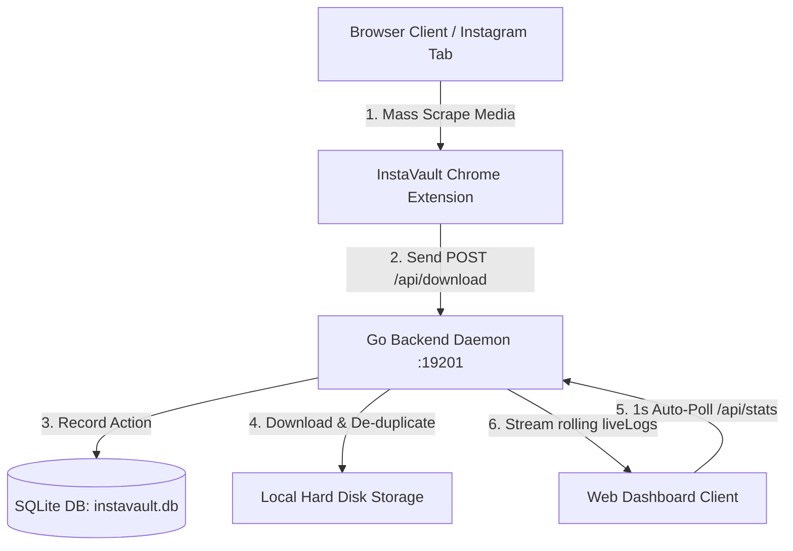

# InstaVault — Instagram Mass Downloader Ecosystem

InstaVault is a premium, state-of-the-art media archiving and download management system designed for mass-archiving Instagram profiles, carousels, videos, and stories. The project couples a browser scraping extension with a high-performance Go backend daemon and a stunning web-based dashboard console.

---

## 🏗️ Ecosystem Architecture



1. **Chrome Extension**: Scrapes media identifiers, profiles, high-resolution source URLs, and indexing numbers directly from active Instagram tabs, sending a structured payload sequence back to the local daemon.
2. **Go Backend Daemon**: Serves an active API server on local port `19201`. It processes concurrent download queues, handles database indexing via SQLite, sanitizes paths, and performs automatic de-duplication to prevent redownloading items.
3. **Web Dashboard Dashboard**: Built on Tailwind CSS, showcasing deep slate glassmorphism, Outfit and Plus Jakarta typography, responsive collapsibility, grouped post accordions, and a real-time, terminal-like download sync stream.

---

## ⚡ Key Highlights & Features

### 1. Grouped Instagram Post Accordions
- Groups flat download history rows on-the-fly by their unique Instagram **Shortcode**.
- Uses an expandable accordion design with smooth slide-down animation heights (`transition-all duration-300`).
- Provides quick-action links to instantly open the original Instagram post (`instagram.com/p/{shortcode}`) in a new tab.

### 2. Permanent Live Extension Console
- Houses a custom scrolling terminal console (`bg-slate-950 p-4 border font-mono text-[11px] rounded-2xl`) directly inside the dashboard.
- Displays the precise, step-by-step lifecycle of each active download triggered by your browser:
  - `🔄 DL`: Downloading (blue text + animated spinning loader).
  - `✅ OK`: Download complete (emerald text + final file size formatted in MB).
  - `⏭️ SKIP`: Bypassed duplicate file (amber text).
  - `❌ ERR`: Failed download (rose text + inline error details).
- Automatically scrolls downward as new logs stream in from the Go server.
- Automatically transitions the console status badge from `IDLE` to `🟢 ACTIVE SYNC` (pulsing emerald glowing ping) during active crawls, and retains the log lines permanently when finished so you can review the history at any time.
- Operates on a highly responsive **1.0-second (1000ms)** polling interval for instant UI updates.

### 3. Stripe-Style Emerald Storage Capacity Metrics
- Monitors disk space limits of your active download workspace directory in real-time.
- Utilizes an ultra-low-overhead, platform-independent disk manager in Go via native `syscall.Statfs` standard bindings.
- Incorporates a recursive directory-upwalk resolver to find parent volumes if the target download folders have not been created on disk yet.
- Visualizes metrics in a beautiful **Emerald** layout card:
  - Details used volume (e.g. `62.9 GB / 198 GB`) and calculates percentage capacity.
  - Showcases an animated, CSS-transitioned fluid progress bar.
  - Updates seamlessly in rolling 1-second interval loops.

### 4. Customizable Multi-Tier Folder Layouts
- Replaces flat sorting directories with three fully custom organization structures to automate folder management:
  1. **Profile Folder** (Default: `{base_dir}/{username}/{filename}`): Sorts files inside individual user profile folders.
  2. **Flat Folder** (Flat Layout: `{base_dir}/{filename}`): Saves all downloads in a single global target directory.
  3. **Profile + Media Type** (Grouped: `{base_dir}/{username}/photos/...` or `{base_dir}/{username}/videos/...`): Group downloads by user, then auto-segregates stills (carousels, images) and moving pictures (reels, MP4s) into dedicated nested media folders.
- Controlled via an ultra-premium simulated dropdown popover menu featuring sub-label option metadata, chevron rotate animations, spring active bullet indicators, and click-outside closure helpers.
- Fully persisted inside the backend's SQLite `settings` schema, syncing automatically across server restarts and client loads.

---

## ⚙️ Development & Deployment

To make pair-programming and deployment completely painless, we use an advanced automated deployment script at the root directory:

### The Five-Stage Deployment Flow (`deploy.sh`)
Running `./deploy.sh` automatically coordinates the following operations:
1. 📦 **Compilation**: Compiles the Go server using the workspace sources.
2. 🔄 **Binary Synchronization**: Synchronizes the compiled binary to the operational execution folder (`~/mass-downloader-for-instagram/server/`).
3. 🎨 **Asset Synchronization**: Copies all UI elements (HTML, CSS, JS) to the operational paths.
4. ⚡ **Daemon Reload**: Triggers a systemd user daemon restart (`systemctl --user restart instavault.service`).
5. 🔍 **Active Health-Check**: Performs a **multi-attempt ping routine** to `http://localhost:19201/api/stats` to verify if the server successfully bound and is serving requests. If a failure occurs, it instantly outputs the service logs (`journalctl`) to aid in debugging!

### To Deploy & Run:
Make the deployment script executable and run it:
```bash
chmod +x ./deploy.sh
./deploy.sh
```

---

## 🛠️ Daemon Service Settings

The server runs as a background systemd user service located at:
`~/.config/systemd/user/instavault.service`

### Service Management Commands:
- **Restart Server**: `systemctl --user restart instavault.service`
- **View Active Status**: `systemctl --user status instavault.service`
- **Check Recent Logs**: `journalctl --user -u instavault.service -f`
