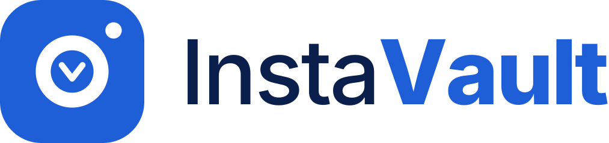
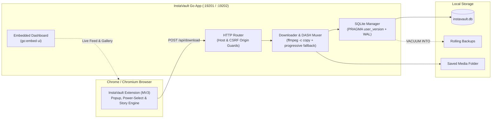

<p align="center">
  <picture>
    <source media="(prefers-color-scheme: dark)" srcset="InstaVault-Brand-Kit/logo/svg/logo-horizontal-reversed.svg">
    <source media="(prefers-color-scheme: light)" srcset="InstaVault-Brand-Kit/logo/svg/logo-horizontal.svg">
    
  </picture>
</p>

<p align="center">
  <strong>Local-first media archiver and library dashboard for Instagram.</strong><br/>
  Pure-Go background app paired with a Manifest V3 Chrome extension.
</p>

<p align="center">
  <a href="#quick-start"></a>
  <a href="#architecture"></a>
  <a href="InstaVault-Brand-Kit/brand-guidelines.html"></a>
  <a href="LICENSE"></a>
</p>

---

## Features

- **Posts, Carousels, Reels, Stories & Highlights**: RelayModern `POST /graphql/query` engine with live `fb_dtsg` tokens, high-resolution `wd`/`dpr` cookies, and a `MAIN`-world React Fiber bridge for reliable user resolution.
- **One-Click Post Page Saving**: Opening any `/p/<code>/`, `/reel/<code>/`, or `/tv/<code>/` post shows a floating **Save this post** action that archives the open post and all of its carousel slides directly, with no manual selection needed.
- **Dedicated Story & Highlight Bar**: Save just the current slide (**Save this slide**), all open stories/highlights, or all followed stories from a persistent floating bar.
- **Power-Select Manual Mode**: Select posts individually, **Shift+Click** a span, **Select all loaded**, or pick **First N** posts and manually uncheck any you want to skip—alongside hands-free **Download by post range** and **Download by timeframe**.
- **Maximum Quality via Go-Server DASH Muxing**: Automatically extracts the highest-resolution DASH video and audio streams and remuxes them losslessly (`ffmpeg -c copy -movflags +faststart`) on the local Go server, with automatic fallback to progressive MP4 if `ffmpeg` is not installed.
- **Smart Deduplication & MIME Detection**: SQLite-backed deduplication skips already-saved media and aligns image file extensions (`webp`, `avif`, `png`, `jpg`) to the actual `Content-Type`.
- **Local Web Dashboard**: Zero-dependency embedded dashboard (`http://localhost:19201`) with a live activity feed, gallery view (Masonry & 1:1 Square), lightbox inspector, disk storage gauge, and folder organization settings.

---

## Quick Start

### Windows (PowerShell)

**Direct install from GitHub** (no clone or Go toolchain required):
```powershell
irm https://raw.githubusercontent.com/vampdued/instavault/main/scripts/install.ps1 | iex
```

**Install from a local clone:**
```powershell
.\dev.ps1 install
```

### Linux & macOS

**Direct install from GitHub:**
```bash
curl -fsSL https://raw.githubusercontent.com/vampdued/instavault/main/scripts/install.sh | bash
```

**Install from a local clone:**
```bash
./scripts/install.sh
```

### Load the Chrome Extension

1. Open `chrome://extensions` in Chrome, Brave, or Edge.
2. Enable **Developer mode** (top-right).
3. Click **Load unpacked** and select the staged extension folder:
   - **Windows:** `%LOCALAPPDATA%\InstaVault\extension`
   - **Linux / macOS:** `~/.local/share/instavault/extension`
4. Click the **InstaVault** toolbar icon to confirm the app is connected and open the Dashboard (`http://localhost:19201`).

> **Optional (Recommended):** Install [`ffmpeg`](https://ffmpeg.org/) on your system `PATH` to enable lossless high-bitrate DASH video + audio muxing. Without `ffmpeg`, InstaVault automatically falls back to progressive MP4 downloads.

### Uninstall

```powershell
# Windows (add -PurgeData to also delete the database, settings, and logs)
.\scripts\uninstall.ps1
```

```bash
# Linux / macOS (add --purge-data to also delete ~/.local/share/instavault)
./scripts/uninstall.sh
```

---

## Architecture



---

## Local Development

On Windows, all development and release tasks are centralized in [`dev.ps1`](dev.ps1):

| Command | Action |
|---|---|
| `.\dev.ps1 run` | Start dev server on port **`19202`** with live UI hot-reloading (`server/ui`) and isolated dev data. |
| `.\dev.ps1 test` | Run the full Go unit test suite (`go test -v ./...`). |
| `.\dev.ps1 check` | Run isolated database self-check and migration verification (`-selfcheck -dev`). |
| `.\dev.ps1 build` | Compile production Windows binary (`server/instavault-server.exe`). |
| `.\dev.ps1 pack` | Build release zips and `checksums.txt` in `dist/`. |
| `.\dev.ps1 install` | Build and install locally to `%LOCALAPPDATA%\InstaVault`. |
| `.\dev.ps1 uninstall` | Stop and remove the local installation (supports `-PurgeData`). |
| `.\dev.ps1 update` | Check GitHub Releases and apply self-update with automatic rollback. |
| `.\dev.ps1 clean` | Remove build artifacts in `dist/`. |

On Linux/macOS, run the dev server directly:
```bash
cd server && go run . -dev
```

---

## Security Model

- **DNS Rebinding Protection**: `validateHostMiddleware` validates the `Host` header on every request.
- **CSRF / Origin Guard**: `csrfMiddleware` validates `Origin` on mutating endpoints (`POST`, `PUT`, `DELETE`), allowing missing `Origin` only from loopback (`127.0.0.1`, `::1`).
- **Loopback-Only Shutdown**: `/api/shutdown` is restricted to loopback connections.
- **Safe CLI Updates**: Updates run via `instavault-server -update`, verify SHA256 checksums, test migrations against a `VACUUM INTO` backup, and roll back automatically if `/api/version` fails within 20s.

---

## Repository Structure

```text
instavault/
├── InstaVault-Brand-Kit/    # Vector logos, icons, tokens & brand guidelines
├── extension/               # Chrome Manifest V3 extension (English-only)
│   ├── _locales/en/         # UI copy
│   ├── css/                 # Popup & Instagram overlay stylesheets
│   ├── icons/               # Brand Kit icons & UI glyphs
│   ├── js/                  # app.js, bg.js, popup.js, story-engine.js, story-bridge.js
│   ├── manifest.json
│   └── popup.html
├── scripts/                 # Unified cross-platform install/uninstall scripts
│   ├── install.ps1          # Windows (local clone or direct GitHub release)
│   ├── uninstall.ps1        # Windows uninstaller
│   ├── install.sh           # Linux & macOS (local clone or direct GitHub release)
│   └── uninstall.sh         # Linux & macOS uninstaller
├── server/                  # Pure-Go backend & embedded dashboard
│   ├── internal/update/     # CLI updater, checksums & rollback tests
│   ├── ui/index.html        # Embedded SPA dashboard
│   └── main.go
├── dev.ps1                  # Windows local dev & packaging helper
└── LICENSE                  # MIT License
```

---

## License

Released under the [MIT License](LICENSE).
