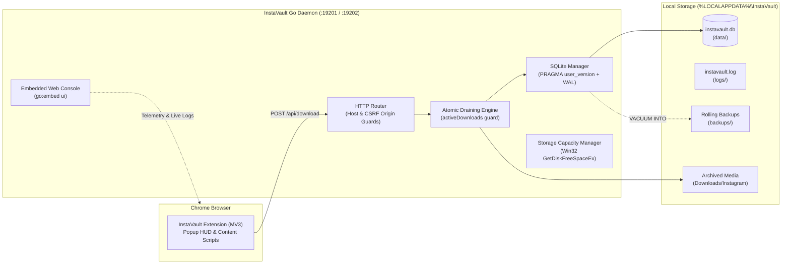
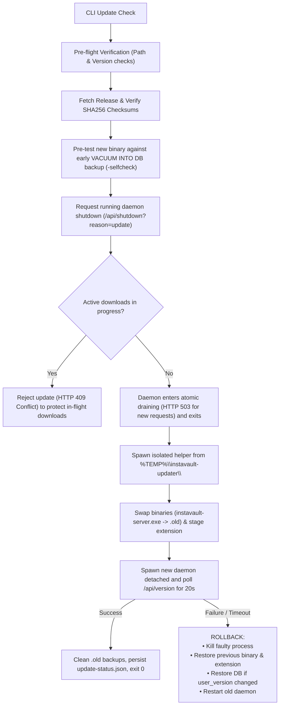

# InstaVault

A local-first media archiving and synchronization ecosystem for Instagram. InstaVault pairs an unpacked **Manifest V3 Chrome extension** with a high-performance **pure-Go backend daemon** and an embedded real-time web dashboard.

---

## 🏗️ Architecture



### Key Components
1. **Chrome Extension** ([`extension/`](file:///c:/Users/VampDued/Documents/mass-downloader-for-instagram/extension)): Scrapes full-resolution carousel photos, videos, and profile metadata. Configurable daemon endpoint (defaults to `:19201`, switches to `:19202` for dev mode).
2. **Go Daemon** ([`server/`](file:///c:/Users/VampDued/Documents/mass-downloader-for-instagram/server)): Compiled with `CGO_ENABLED=0` using `modernc.org/sqlite`. Runs headless on Windows (`-H=windowsgui`) with STD handles redirected to logs.
3. **Web Console** ([`server/ui/`](file:///c:/Users/VampDued/Documents/mass-downloader-for-instagram/server/ui)): Deep slate aesthetic, live tail console, shortcode post grouping, real-time disk storage gauge, and zero-dependency SPA architecture embedded via `go:embed`.

---

## ⚡ Quick Start (Windows 11)

### 1. Automated Installation
Run the installer from PowerShell:
```powershell
.\install.ps1
```
The installer:
- Deploys the binary to `%LOCALAPPDATA%\InstaVault\bin\instavault-server.exe`.
- Configures background auto-start via your Windows Startup folder.
- Stages the Chrome extension to `%LOCALAPPDATA%\InstaVault\extension\`.
- Starts the background service on port **`19201`**.

### 2. Load Extension into Chrome
1. Navigate to `chrome://extensions` in Google Chrome.
2. Enable **Developer mode** (toggle in top-right corner).
3. Click **Load unpacked** and select:
   ```text
   C:\Users\<YourUser>\AppData\Local\InstaVault\extension
   ```
4. Click the InstaVault toolbar icon to view connection telemetry and launch the Web Vault.

### 3. Uninstallation
To remove the background service and binaries:
```powershell
.\uninstall.ps1
```
*Add `-PurgeData` to permanently remove databases, settings, and logs.*

---

## 🛠️ Local Development & Automation

All local tasks are managed through [`dev.ps1`](file:///c:/Users/VampDued/Documents/mass-downloader-for-instagram/dev.ps1) from the repository root:

| Command | Action |
|---|---|
| `.\dev.ps1 run` | Starts development daemon on port **`19202`** with live hot-reloading from disk (`server/ui`) and isolated dev database (`dev-data/`). Never collides with production. |
| `.\dev.ps1 test` | Executes the complete Go test suite including updater mock servers and rollback verification. |
| `.\dev.ps1 check` | Runs an isolated database self-check and schema migration test (`-selfcheck -dev`). |
| `.\dev.ps1 build` | Compiles production Windows binary with `-ldflags "-s -w -H=windowsgui -X main.Version=..."`. |
| `.\dev.ps1 pack` | Generates distribution packages in `dist/` (`instavault-windows-amd64.zip`, `instavault-extension.zip`, and `checksums.txt`). |
| `.\dev.ps1 update` | Checks GitHub Releases for updates via the CLI updater. |
| `.\dev.ps1 clean` | Removes build and packaging artifacts. |

---

## 🔄 CLI Updates & Rollback Engine

Updates are initiated via CLI without exposing destructive in-app HTTP mutation endpoints:

```powershell
.\server\instavault-server.exe -update
# or
.\dev.ps1 update
```



### Safeguards:
- **Zero-In-Use Locks**: The update helper runs out of `%TEMP%`, leaving `%LOCALAPPDATA%\InstaVault\bin\instavault-server.exe` unlocked for clean replacement and `.old` deletion.
- **Active Download Protection**: Updating is refused if downloads are actively in flight.
- **Conditional Database Rollback**: The live database is rolled back only if the candidate binary executed migrations (`user_version` bump). Otherwise, all user data is preserved.
- **Extension Synchronization**: Updated extension files are staged alongside the binary. If a newer extension is required, the popup surfaces a prompt: *"Extension Update Required: Click ↺ Reload on chrome://extensions"*.

---

## 🔒 Security Model

- **DNS Rebinding Defense**: `validateHostMiddleware` checks the `Host` header on all requests, rejecting unauthorized hosts.
- **CSRF / Origin Guard**: `csrfMiddleware` enforces strict Origin checks on all mutating methods (`POST`, `PUT`, `DELETE`). Non-browser local tools (CLI, PowerShell) are permitted without an Origin header only when `RemoteAddr` is loopback (`127.0.0.1`, `::1`).
- **Loopback-Only Administration**: Daemon shutdown (`/api/shutdown`) is strictly restricted to loopback connections.
- **Zip-Slip Protection**: Extension and binary archive extraction uses path sanitization to reject directory traversal exploits.

---

## 📂 System File Hierarchy

```text
%LOCALAPPDATA%\InstaVault\
├── bin\
│   └── instavault-server.exe       # Installed production binary (headless)
├── data\
│   ├── instavault.db               # SQLite database (WAL mode)
│   ├── instavault.pid              # Active daemon process ID
│   └── update-status.json          # Persistent updater telemetry
├── logs\
│   ├── instavault.log              # Daemon runtime logs (rotated at 10MB)
│   └── update.log                  # Updater swap & rollback history
├── backups\
│   └── instavault.db.v*.bak        # Rolling VACUUM INTO database snapshots
└── extension\                      # Staged unpacked Chrome extension files
```

---

## 🐧 Cross-Platform / Linux Notes

While the automated installer (`install.ps1`) and GUI launcher are tailored for Windows 11, the core Go daemon compiles cleanly for Linux and macOS (`CGO_ENABLED=0`):

- **OS Separation**: Windows-specific Win32 Mutex, STD handle redirection, and disk metrics live in `proc_windows.go` and `disk_windows.go`. Platform stubs live in `proc_unix.go` and `disk_unix.go`.
- **Manual Linux Build**:
  ```bash
  cd server
  CGO_ENABLED=0 GOOS=linux GOARCH=amd64 go build -ldflags "-s -w" -o instavault .
  ```
- **Legacy Linux Scripts**: Relocated to [`scripts/linux/`](file:///c:/Users/VampDued/Documents/mass-downloader-for-instagram/scripts/linux) (`deploy.sh`, `uninstall.sh`).
